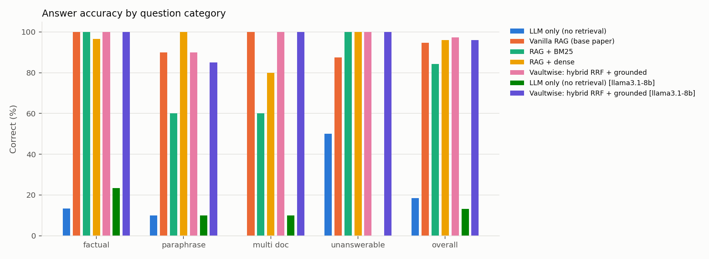
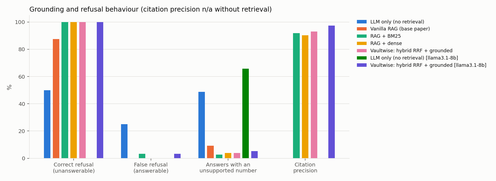
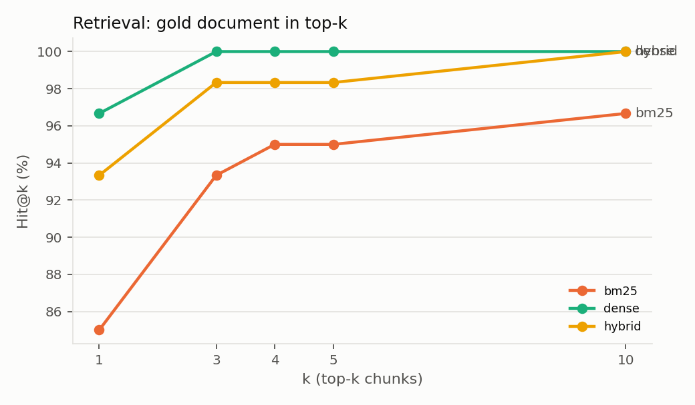
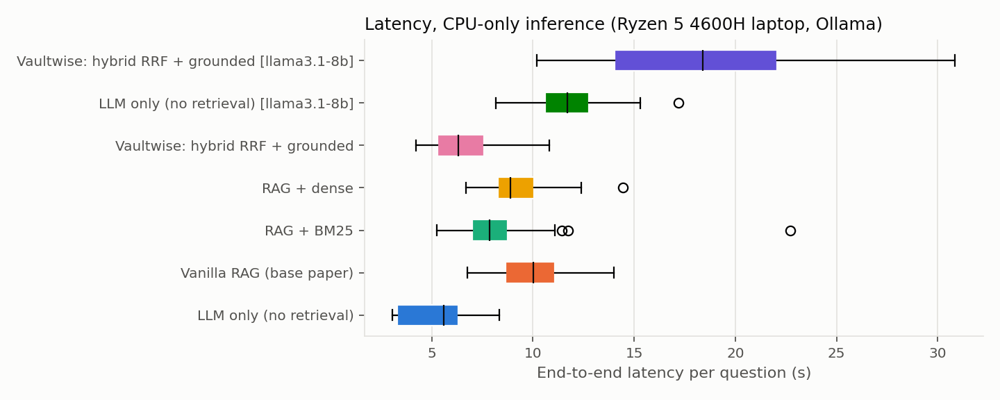

# Vaultwise: Private, Trustworthy Retrieval-Augmented Generation over Company Documents

*Vaultwise was developed as "PolicyPilot" and renamed when its use moved from company-policy Q&A to a private
vault for any document a company shares with an employee. The method and every number in this report are
unchanged. The two evaluated prompts keep the original name so the results remain exactly reproducible.*

**Base paper:** P. Lewis et al., *Retrieval-Augmented Generation for Knowledge-Intensive NLP Tasks*, NeurIPS 2020.
**Supporting method:** G. Cormack, C. Clarke, S. Büttcher, *Reciprocal Rank Fusion outperforms Condorcet and
individual Rank Learning Methods*, SIGIR 2009.

All numbers below are produced by `eval/report.py` from the raw outputs in `results/runs/` and can be
regenerated with the commands in §7. Full tables: [results/results.md](../results/results.md); every failure:
[results/failures.md](../results/failures.md).

---

## 1. Problem, base paper and research question

**Industry problem.** Companies share long documents with employees (policies, contracts, project briefs,
vendor agreements, confidential memos). Employees need *specific* facts from them quickly: a deadline, a notice
period, a payment term. Many of these documents may not be pasted into online AI tools. An LLM assistant can
help, but here a *wrong* answer is worse than no answer: an invented entitlement, limit or deadline creates
financial and compliance risk. The system must therefore (a) answer only from the document, (b) say so when
the document is silent, (c) let the user verify the source, and (d) run entirely on the user's machine.

**Base paper (Lewis et al., 2020).** RAG retrieves the top-k passages with a dense retriever and conditions
the generator on them. This reduces hallucination compared with a parametric-only model. As specified, it:
1. retrieves with a **single dense retriever**,
2. **always generates an answer**: it has no abstention when the passages do not contain the answer,
3. gives **no source attribution** a user can check.

These three properties are the gaps for enterprise use. We replicate the base paper's *architecture*
(dense retrieval → generator conditioned on the passages), not its training procedure. The original RAG
fine-tunes DPR + BART end-to-end; we use a frozen, locally hosted instruction-tuned LLM, as is common in industry.

**Proposed improvements (Vaultwise).**

| # | Gap in base paper | Improvement | Measured by |
|---|---|---|---|
| 1 | Single dense retriever misses exact terms and amounts | **Hybrid retrieval**: BM25 + dense fused with Reciprocal Rank Fusion (Cormack et al., 2009) | Hit@k, MRR, answer accuracy |
| 2 | Always answers, even when the documents are silent | **Grounded prompt with explicit abstention** (a fixed refusal sentence when the context lacks the answer) | correct-refusal rate on unanswerable questions, hallucinated numbers |
| 3 | No attribution | **Document-level citations** `[doc-id]`, parsed and validated against the index | citation precision / recall, fabricated-citation rate |

**Research question.** *Compared with the base-paper RAG setup and with an LLM without retrieval, does
Vaultwise (hybrid RRF retrieval + grounded, citing, abstaining generation, running locally) give answers to
employees' questions about company documents that are equally correct and more trustworthy (correct refusals,
fewer invented facts, verifiable citations) at acceptable latency on commodity hardware?*

The question is answered with two evaluations that match the two ways the system is used:

| Evaluation | Use it represents | Data | Section |
|---|---|---|---|
| **1. Company-policy knowledge base** | search across a set of company policies | 18 policies, 76 questions | §3.1, §4.1–4.4 |
| **2. Private company documents** | ask about, and summarise, one document the company shared with you | contract, confidential memo, held-out vendor agreement; 38 questions + 6 summaries | §3.2, §4.5 |

**Hypotheses.**
- H1: Retrieval of any kind greatly improves correctness over the no-retrieval LLM (both evaluations).
- H2: Hybrid retrieval is at least as good as either single retriever, and better than BM25 on paraphrased questions (evaluation 1).
- H3: Grounded generation raises correct refusals and lowers invented facts relative to vanilla (base-paper) RAG, without lowering accuracy on answerable questions (both evaluations).
- H4: The system generalises to a document not seen during development (evaluation 2, held-out document), and whole-document summaries cover the key facts without inventing numbers.

---

## 2. System (technical implementation)

```
documents (.md) → section-aware chunks ("Title > Section" header, ≤120 words)
                → BM25 index (rank_bm25) + nomic-embed-text embeddings (cached; fingerprint-based rebuild)
question → BM25 top-20 + dense top-20 → RRF (k=60) → top-4 chunks
        → grounded prompt → llama3.2:3b via Ollama (temperature 0, seed 42)
        → answer + parsed citations + refusal flag + sources + latency
        → FastAPI (/ask, /feedback, /documents, /health, /admin/reindex), web UI, JSONL audit log
```

| Component | Implementation | File |
|---|---|---|
| Chunking | split on `##` headings; long sections windowed (120 words, 30 overlap); each chunk prefixed with `Title > Section` | `src/vaultwise/ingest.py` |
| Lexical retrieval | BM25 (Okapi) with number normalisation (`2,00,000` → `200000`) and plural folding | `src/vaultwise/retrieval.py` |
| Dense retrieval | `nomic-embed-text` (768-d) with task prefixes, cosine similarity | `src/vaultwise/retrieval.py` |
| Fusion | RRF: score(d) = Σ 1/(60 + rank) | `src/vaultwise/retrieval.py` |
| Generation | `llama3.2:3b` (also `llama3.1:8b`) on Ollama, CPU-only | `src/vaultwise/llm.py`, `pipeline.py` |
| Citations | `[doc-id]` and `[n]` resolved to indexed documents; unknown ids recorded as fabricated | `src/vaultwise/pipeline.py` |
| Abstention | prompt rule plus a regex refusal detector | `src/vaultwise/pipeline.py` |
| Private documents | PDF/DOCX/TXT/MD extraction, clause-heading detection, categories, view/delete; stored outside the synced project folder | `src/vaultwise/documents.py` |
| Document-scoped answering | retrieval filtered to the chosen document(s); a prompt that names the clause, applies general rules, and separates different-subject clauses | `src/vaultwise/pipeline.py` |
| Summaries | whole document, map-reduce in ~1,500-word parts; `llama3.1:8b` | `src/vaultwise/pipeline.py` |
| Privacy controls | refuses a non-local model server; private questions logged as metadata only; binds to 127.0.0.1; no external web resources | `config.py`, `api.py` |
| Serving | FastAPI with request validation, admin key, query and feedback logs; web dashboard; one-command launcher `run.bat` | `src/vaultwise/api.py`, `static/index.html` |
| Tests | 39 pytest tests (chunking, BM25, RRF, citation/refusal parsing, metrics, API, uploads, summaries, privacy, label consistency of both evaluation sets) with a fake LLM | `tests/` |

All models run locally, so no question or document leaves the machine.

---

## 3. Experimental setup

### 3.1 Evaluation 1: company-policy knowledge base

**Corpus.** 18 policy documents of a fictional company, Veridian Systems (HR, finance, IT, security,
benefits; 116 chunks). Topics deliberately overlap (leave appears in two documents; reimbursements in four)
so that retrieval is not trivial.

**Evaluation set.** 76 hand-written questions in `data/eval/questions.jsonl`, each with gold document id(s),
a reference answer and *key facts*: the exact values a correct answer must state.

| Category | n | What it tests |
|---|---|---|
| factual | 30 | direct lookup, wording close to the document |
| paraphrase | 20 | employee wording ("I'm the dad", "pen drive"), low word overlap |
| multi_doc | 10 | answer needs 2–3 documents, or one calculation |
| unanswerable | 16 | plausible questions the documents do **not** answer (bereavement leave, stock options…) |

A unit test checks that every key fact actually appears in its gold document, which guards against label errors.

**Systems compared (same LLM, same top-k = 4, same questions).**

| System | Retrieval | Prompt | Role |
|---|---|---|---|
| LLM only | none | answer, refuse if unknown | baseline 1 (no RAG) |
| Vanilla RAG | dense | "answer using the context" | **baseline 2 = base paper** |
| RAG + BM25 | BM25 | grounded | ablation |
| RAG + dense | dense | grounded | ablation (isolates improvement 2) |
| **Vaultwise** | hybrid RRF | grounded | proposed |
| + `llama3.1:8b` variants | — | — | model-size ablation |

**Metrics (all deterministic, no LLM judge).**
- *Retrieval:* Hit@k (a gold document among the top-k chunks), Recall@k, MRR.
- *Answer accuracy:* answerable questions are correct when **all** key facts appear (number-normalised,
  word-boundary matching); unanswerable questions are correct when the system declines.
- *Trust:* correct-refusal rate, false-refusal rate, **unsupported-number rate** (the answer states a number
  absent from the gold documents and question, a hallucination proxy), citation precision/recall, fabricated-citation rate.
- *Cost:* p50/p95 end-to-end latency.
- *Statistics:* 95% bootstrap confidence intervals (5,000 resamples); exact McNemar test on paired per-question correctness.

**Configuration.** `config.yaml`; temperature 0, seed 42, `num_ctx` 4096; hardware: Ryzen 5 4600H laptop, 15 GB RAM,
CPU-only inference (Ollama did not offload to the 4 GB GTX 1650). Model digests are recorded in `results/run_metadata.json`.

### 3.2 Evaluation 2: private company documents

**Documents** (fictional, in `samples/`): an employment contract (11 clauses), a confidential project memo
(6 sections) and a vendor master services agreement (10 clauses). The contract and memo were used while the
document-scoped prompt was developed (8 development questions), so they form the `dev_doc` split. The vendor
agreement was written only for this test and never shown to the system before, so it forms the **`held_out`**
split and estimates performance on an unseen company document.

**Questions.** 38 new questions in `data/eval/private_questions.jsonl`, none of them a development question:
factual (23), paraphrase (7), general_rule (3: a general rule in the document covers the question, e.g. "public
channels" covers a public Slack community), and unanswerable (5: plausible but absent, e.g. a GST number).
Split: 23 questions on the two `dev_doc` documents, 15 on the `held_out` vendor agreement.
Each has key facts that a unit test checks against the document text.

**Systems** (same generator `llama3.2:3b`, retrieval restricted to the question's document, top-k = 4):

| System | Retrieval | Prompt | Role |
|---|---|---|---|
| No search | none | general-knowledge prompt; the model never sees the document | baseline 1 |
| Vanilla RAG | dense | "answer using the context" | **baseline 2 = base paper** |
| **Vaultwise** | hybrid RRF | document-scoped grounded prompt | proposed |

**Summaries.** Each document is summarised by `llama3.2:3b` and `llama3.1:8b`. Coverage = share of 8 pre-defined
key facts per document present in the summary; unsupported numbers = numbers in the summary that do not occur in
the document. Metrics and statistics are the same as evaluation 1. Citation metrics are not reported for
evaluation 2: in single-document mode the source is known, so citations are filled in automatically.

The evaluation vault is built from the sample files in an isolated folder (never the user's real vault), with a
fixed date stamp so the index is identical on every run.

---

## 4. Results

### 4.1 Retrieval (60 answerable questions)

| Retriever | Hit@1 | Hit@4 (= LLM context) | Recall@4 | MRR |
|---|---|---|---|---|
| BM25 | 85.0% | 95.0% | 93.3% | 0.893 |
| Dense | **96.7%** | **100.0%** | **100.0%** | **0.981** |
| Hybrid (RRF) | 93.3% | 98.3% | 98.3% | 0.958 |

BM25 fails on paraphrases (Hit@4 85% against 100% on factual questions). Dense retrieval is the strongest single retriever
on this corpus. RRF fusion is slightly *below* dense alone in retrieval, because one paraphrase (p01, "I'm the
dad") is pulled down by BM25 matches on "leave".

**Chunking ablation** (Hit@1 / Recall@4, hybrid): section-aware 93.3% / 98.3%; naive fixed windows of 150 words
90.0% / 98.3%; whole documents 86.7% / 98.3%. Section-aware chunks give the best top-1 ranking at the smallest
context size (36 words on average, against 207 for whole documents).

### 4.2 End-to-end answers (76 questions, `llama3.2:3b`)

| System | Overall acc. [95% CI] | Answerable acc. | Correct refusal (16 unanswerable) | Unsupported-number rate | Answers with valid citation | p50 latency |
|---|---|---|---|---|---|---|
| LLM only | 18.4% [11–28] | 10.0% | 50.0% | 48.7% | n/a | 5.6 s |
| Vanilla RAG (base paper) | 94.7% [89–99] | 96.7% | 87.5% | 9.2% | 0% | 10.0 s |
| RAG + BM25 | 84.2% [76–92] | 80.0% | 100% | 2.6% | 91.7% | 7.9 s |
| RAG + dense | 96.1% [91–100] | 95.0% | 100% | 3.9% | 88.3% | 8.9 s |
| **Vaultwise** | **97.4% [93–100]** | **96.7%** | **100%** | **3.9%** | **85.0%** | **6.3 s** |

Accuracy by category (Vaultwise / vanilla RAG / BM25): factual 100 / 100 / 100; paraphrase 90 / 90 / 60;
multi-doc 100 / 100 / 60; unanswerable 100 / 87.5 / 100.

**Paired significance (McNemar, Vaultwise vs …).**

| Comparison | Vaultwise-only correct | other-only correct | p |
|---|---|---|---|
| LLM only | 60 | 0 | < 0.0001 |
| RAG + BM25 | 10 | 0 | 0.002 |
| Vanilla RAG (base paper) | 4 | 2 | 0.69 |
| RAG + dense | 3 | 2 | 1.00 |

### 4.3 Model-size ablation (`llama3.1:8b`)

| System | Overall acc. | Correct refusal | Unsupported-number rate | Valid citation / fabricated id | p50 latency |
|---|---|---|---|---|---|
| LLM only, 8B | 13.2% | **0%** | 65.8% | n/a | 11.7 s |
| Vaultwise, 8B | 96.1% | 100% | 5.3% | 96.7% / 0% | 18.4 s |
| Vaultwise, 3B | 97.4% | 100% | 3.9% | 85.0% / 11.7% | 6.3 s |

### 4.4 Interpretation

- **H1 supported, strongly.** Without retrieval the model answers 10% of answerable questions correctly
  and invents numbers in half of its answers (for example "5 paid bereavement days" and a "$25 gift limit").
  The larger 8B model is *worse*: it declined **none** of the 16 unanswerable questions, inventing a CEO
  name, a Wi-Fi password and a 401(k) policy. Model size does not substitute for retrieval.
- **H2 partly supported.** Hybrid is significantly better than BM25 (+13.2 points, p = 0.002), driven by
  paraphrase and multi-document questions. It is **not** significantly better than dense retrieval (p = 1.0);
  on this small, well-written corpus dense retrieval alone is already near the ceiling. Hybrid's value is as a
  safeguard for exact identifiers (amounts, form and portal names), which this corpus tests only lightly.
- **H3 supported on trust, not on accuracy.** Against the base-paper setup, Vaultwise keeps the same
  answerable accuracy (96.7% for both), raises correct refusals from 87.5% to 100%, more than halves the
  unsupported-number rate (9.2% → 3.9%), adds citations to 85% of answers, and is faster (6.3 s against 10.0 s,
  because shorter grounded answers mean fewer generated tokens). The overall accuracy difference is not
  statistically significant (p = 0.69, 6 discordant questions). With 16 unanswerable questions, the refusal
  gain (2 hallucinations eliminated) is a clear direction but a small sample.
  A practical difference the metric understates: vanilla RAG's refusals are free-form ("There is no
  information provided…"), so a program cannot reliably detect them. Vaultwise's fixed refusal sentence lets
  the application flag the answer and route the question to a human.
- **Deployment choice.** The 3B model matches the 8B on accuracy at about 3× lower latency. The 8B is preferable
  only where exact citations are mandatory (0% fabricated ids against 11.7%).

### 4.5 Evaluation 2: private company documents (38 questions, `llama3.2:3b`)

Full tables: [results/private_results.md](../results/private_results.md); failures:
[results/private_failures.md](../results/private_failures.md); manual audit: `results/private_audit.csv`.

| System | Overall acc. [95% CI] | Answerable acc. | Correct refusal (5) | Unsupported-number rate | Held-out document acc. (15) | p50 latency |
|---|---|---|---|---|---|---|
| No search | 15.8% [5–29] | 6.1% | 80.0% | 7.9% | 20.0% | 3.0 s |
| Vanilla RAG (base paper) | 97.4% [92–100] | 100% | 80.0% | 2.6% | 93.3% | 8.3 s |
| **Vaultwise** | **100% [100–100]** | **100%** | **100%** | 5.3% | **100%** | **6.4 s** |

McNemar, Vaultwise vs no search: 32 vs 0 discordant, p < 0.0001. Vaultwise vs vanilla RAG: 1 vs 0, p = 1.0.

**Manual audit of all 38 Vaultwise answers.** Facts correct 38/38, agreeing with the automatic scorer on every
question. 19 of 33 answerable answers name a clause or section, and **15 of 19** name the right one. The 4 wrong:
c07 attributes the phone allowance to "4. Compensation" (it is in "6. Benefits"); n06 cites "2. Timeline" for a
fact in "1. Purpose"; n04 and v13 invent sub-clauses ("3.2", "10.1"). The last two are exactly the answers
flagged by the unsupported-number metric, so for Vaultwise that metric measures *invented clause numbers*, not
invented facts.

**Whole-document summaries** (key-fact coverage of 8 facts per document; unsupported numbers):

| Model | Contract | Memo | Vendor (held out) | Mean coverage | Unsupported numbers | Mean latency |
|---|---|---|---|---|---|---|
| `llama3.2:3b` | 87.5% | 87.5% | 100% | 91.7% | 0 | 41 s |
| `llama3.1:8b` | 87.5% | 100% | 100% | 95.8% | 0 | 88 s |

**Interpretation.**
- **H1 confirmed again.** Without the document the model answers 2 of 33 answerable questions; mostly it
  declines (78.8% false refusals), and otherwise it gives generic or wrong answers (e.g. that spending above
  INR 10 lakh needs "Central Government" approval).
- **H3: same direction as evaluation 1, too small to be significant.** Both RAG systems answer every answerable
  question. The only difference is refusals: vanilla RAG answered an unanswerable question with an inference the
  agreement does not contain ("the agreement does not prevent the vendor from working for competitors"), while
  Vaultwise declined all 5. One discordant question gives p = 1.0, so evaluation 2 adds consistency, not
  statistical strength, to the trust advantage measured in evaluation 1.
- **H4 supported within its limits.** On the held-out vendor agreement, never seen during development, Vaultwise
  answered 15/15 correctly. That is evidence that the document-mode prompt was not over-fitted to the two
  development documents. But 15 questions on one clean, well-structured document is a ceiling-level test, not proof
  of robustness on long or messy real contracts.
- **Summaries.** Both models cover most key facts with no unsupported numbers. The 8B model covers one more fact
  in 24 (95.8% vs 91.7%) at about twice the latency. This measured difference is small. Using the 8B model for
  summaries rests mainly on the qualitative error found earlier (§6), where the 3B model attached an invented
  day to a real month ("30 March 2027"), a kind of error this metric cannot detect.

---

## 5. Failure analysis and limitations

### 5.1 What still fails (Vaultwise, 3B), from `results/failures.md`

| Question | Error type | Cause | Possible fix |
|---|---|---|---|
| p01 "I'm the dad, how much time off?" | retrieval miss | policy says "non-birthing parent / paternity"; BM25 matches on "leave" outrank it in fusion | synonym/query expansion; weighted RRF favouring dense |
| p14 "If I quit after a sponsored course, do I owe anything?" | generation error | correct document retrieved; model answered about exam retakes instead of the 12-month pro-rata clause | stronger model, or rerank sections before generation |
| 11.7% of answers cite a non-existent id (e.g. `[hr-device-policy]`) | citation hygiene | small model paraphrases document ids | strip or repair ids not in the retrieved set (the 8B model has 0%) |
| p11 (found in manual audit) | self-contradiction | correct facts followed by an unrelated refusal sentence | post-check: an answer containing key content and a refusal → drop the refusal |

Error attribution across all 76 questions: Vaultwise 74 ok, 1 retrieval miss, 1 generation error.
BM25 RAG: 3 retrieval misses, 6 generation errors, 3 partial answers. Vanilla RAG: 2 partial answers, 2 answered-unanswerable.

**Evaluation 2 (private documents).** No factual errors, but two failure types that matter to a user who checks
the source:

| Failure | Frequency | Example | Possible fix |
|---|---|---|---|
| Wrong or invented clause reference | 4 of 19 clause references | "clause 3.2" when the memo has only section 3; allowance attributed to "Compensation" instead of "Benefits" | take the clause name from the retrieved chunk's section field instead of letting the model write it |
| Prompt rule not followed | 14 of 33 answers name no clause | "Your probation period is 3 months." | show the retrieved section in the UI (already done) or append it automatically |
| Rambling before the answer | 1 of 38 | c07 lists two irrelevant clauses before the right fact | stronger model, or a length/format post-check |

### 5.2 Validity of the automatic scorer

- **Manual audit.** 60 answers (15 per 3B system, seeded random sample) were labelled by hand
  (`results/audit_sample.csv`). Agreement with the automatic scorer was **98.3%, Cohen's κ = 0.96**. The only
  disagreement was a scorer false positive on Vaultwise (p11, self-contradiction), so the automatic scorer
  slightly *flatters* the proposed system.
- **Lucky matches favour the baseline.** Of the 6 answerable questions the no-retrieval LLM scored as correct, 3
  were wrong on inspection ("$500,000" for INR 5,00,000; "3–4 years" for 4 years; p15 contradicts policy), so
  the true gap between RAG and no retrieval is *larger* than reported.
- **Refusal detection is pattern-based.** The first detector recognised only Vaultwise's fixed refusal
  sentence and under-counted vanilla RAG's free-form refusals (43.8% instead of 87.5%). We widened the
  patterns, re-scored all stored runs, and verified the 16 vanilla answers by hand. The detector is still a
  likely source of error for new phrasings.
- **The unsupported-number proxy flags correct arithmetic.** Two of Vaultwise's three flags are valid
  calculations (3 × 7,000 = 21,000; 12 × 1,500 = 18,000), so this metric overstates hallucination for
  systems that compute.
- **It also misses a whole class of errors.** It only checks whether each number occurs somewhere in the document.
  A real number in the wrong place ("30 March 2027", where 30 appears elsewhere) is not detected, and neither are
  wrong clause names. Evaluation 2's manual audit found these errors only by reading every answer.
- **A scorer bug found while building evaluation 2, and its impact.** The text normaliser replaced the currency
  "Rs." inside any word ending in "rs.", so "3 years." became "3 yea inr" and could not match. The label-consistency
  test caught it. After the fix, re-scoring all stored evaluation-1 runs changed **no** metric (0 of 35 aggregate
  values), so the reported numbers stand. A regression test now guards it.

### 5.3 Threats to validity

- **Synthetic corpus and author-written questions.** The documents and questions were written by the same
  author, which risks optimism (clean documents, guessable phrasing). Real policies are longer, inconsistent,
  versioned, and often PDFs or tables. The corpus has 18 documents; retrieval is near ceiling, so differences between
  retrievers are compressed.
- **Small sample.** 76 questions give wide confidence intervals (±5–10 points); most differences between the
  RAG variants are not statistically significant. Only differences confirmed by McNemar are claimed.
- **Single run per configuration.** Temperature 0 with a fixed seed is deterministic on this machine, but
  results can differ across Ollama versions and hardware (digests recorded).
- **No tuning on the test set.** Prompts, top-k and RRF k were fixed before the runs, and failures were *not*
  fixed by editing the corpus or prompts, to avoid overfitting the evaluation. The one post-hoc change (the
  refusal detector) affects scoring only and was applied to all systems equally.
- **Development documents vs held-out document (evaluation 2).** The document-mode prompt was refined on 8
  questions about the contract and memo. Evaluation 2 uses 38 *different* questions and reports the held-out
  vendor agreement separately (15/15) so that tuning cannot inflate the headline result, but two of its three
  documents were still seen during development.
- **Ceiling effect in evaluation 2.** Both RAG systems answer every answerable question, so evaluation 2 cannot
  separate them on accuracy; differences appear only in refusals (5 questions). Longer documents, tables,
  scanned PDFs and documents with conflicting clauses would be needed to stress the system.
- **Single language and domain**: English; Indian-company HR/IT policy and business documents.

---

## 6. Industry deployment

- **Data stays on-premise:** Ollama runs the open-weight models locally; no external API calls.
- **Plug in real documents:** drop `.md`/`.txt` exports into `data/corpus/` and `POST /admin/reindex`;
  the index fingerprint detects changes automatically.
- **Operations:** `/health` for monitoring; JSONL audit log of every question, answer, sources and latency;
  thumbs up/down feedback linked by `query_id`. Refused questions show documentation gaps, and thumbs-down answers
  become new evaluation questions, so the test set grows with real traffic.
- **Packaging, two single-command options:** `run.bat` (installs what is missing and starts the app directly), or
  Docker, `docker compose up -d`, which starts three containers: `vaultwise-app` (the web app, published on
  127.0.0.1:8080 only), `vaultwise-ollama` (the AI engine, with no published port, so only the app can reach it) and
  `vaultwise-models` (a one-off that downloads the models, then exits). Documents live in the same vault folder as
  `run.bat` (`~/.vaultwise/uploads`, mounted into the container, never in the synced project folder). The app
  container runs as a non-root user and has a
  health check. Uploads and deletions can be protected with `VAULTWISE_ADMIN_KEY`.
- **Private documents (contracts, policies shared with the employee, confidential files):** the UI section
  *Your private documents* accepts PDF, DOCX, TXT or MD files (or pasted text) with a category. Clause headings
  ("10. Termination and Notice Period") become sections, only the new chunks are embedded (≈3 s for a 465-word
  contract), and *Answer from: Only <document>* restricts retrieval to that document. The user can also
  **View** the stored text at any time and get a **whole-document summary** from the chat box ("summarise
  this"): long documents are summarised in ~1,500-word parts and then merged (map-reduce).
- **Privacy controls for documents that must not go online:** uploads, the index and logs are stored in
  `~/.vaultwise/`, outside the OneDrive-synced project folder. The app refuses a non-local model server
  unless explicitly allowed. Questions about private documents are logged as metadata only (verified: 0
  occurrences of document text or names in 14 logged requests). The server binds to 127.0.0.1, and the page
  loads no external resources.
- **How the document mode was developed** (8 development questions on the contract and memo; the measured
  evaluation of the final version, on 38 different questions and a held-out document, is §4.5):
  - the first prompt answered "yes" to "Is there a non-compete clause?" when the contract has only a
    non-solicitation clause; a clause-aware rule fixed it;
  - that rule then made the model refuse "Can I use ChatGPT to rewrite this memo?" although the memo bans
    public AI chatbots; the rule was refined to apply general rules but not different-subject clauses;
  - after the refinement, 8 of 8 test questions were correct, including the two above and two correctly
    declined questions on each document;
  - the 3B model's memo summary invented a date ("30 March 2027" where the memo says only "March 2027") and
    mislabelled a deadline, while `llama3.1:8b` was accurate (96 s against 38 s), so summaries use the 8B model.
  Private documents are never read by evaluation runs, which use a separate index, so they cannot change §4.
- **Citation post-check (added after the evaluation):** a citation now counts only if the cited document was
  in the model's context, and in single-document mode a missing citation is filled with that document. The
  evaluation-1 numbers (§4.1–4.4) were produced before this change and do not include it; evaluation 2 (§4.5)
  includes it, which is why it reports no citation metrics.
- **Running it:** `run.bat` checks Python, packages, Ollama and models, starts the app on 127.0.0.1 and opens
  the browser (see `RUN_GUIDE.md`). It needs only Python and Ollama; the Docker option needs only Docker.
- **Before production:** add SSO in front of the API, per-user access control for private documents and
  per-department access for policies, encryption at rest for `~/.vaultwise/`, and OCR for scanned PDFs.

### 6.1 Continuous integration pipeline

A GitHub Actions pipeline (`.github/workflows/ci-cd.yml`) runs on every push and pull request
(https://github.com/DamyantGaur/Vaultwise). The start-up and Docker stages run only if the tests pass, and any
failure marks the commit as failed on GitHub.

| Stage | Checks | Fails when |
|---|---|---|
| 1. Test | ruff lint; 39 unit/API tests; **AI quality gate** (`eval/quality_gate.py`): both evaluations are re-scored from the stored outputs with the current code, then 9 thresholds are checked | any test fails, or e.g. accuracy < 95%, policy refusals < 95%, unsupported-number rate > 8%, citation precision < 85%, held-out accuracy < 90%, or the margin over the no-retrieval baseline < 50 points |
| 2. Start-up check | installs the dependencies as a user would, starts the server, checks that `/health` and the dashboard respond | the installation fails, the server does not start, or the app does not respond |
| 3. Docker check | validates `docker-compose.yml`, builds the app image, runs the container, checks that `/health` and the dashboard respond | the compose file is invalid, the image does not build, or the container does not serve the app |

The quality gate is the AI-specific part. A normal CI pipeline only checks that code runs; this one also checks
that **answer quality has not dropped**, using the measurements from §4 as a regression baseline. Running the
real model would make CI slow and costly, so the gate re-scores stored outputs instead.

**No cloud deployment, by design.** Vaultwise's core promise is that confidential documents never leave the
user's computer. A public cloud deployment was prototyped and then removed: documents on a cloud host are no
longer on the user's machine, and the free hosting tiers available could not run the model. Vaultwise is deployed
locally with one command on each employee's own computer: `run.bat`, or `docker compose up -d` for the
containerised version. A company could run the same containers on its own internal server.

### 6.2 Market position

A competitor analysis of 24 products, with prices and data handling verified on 28–29 Oct 2026, is in
`docs/COMPETITORS.md`. In summary:

- **Cloud assistants** (ChatGPT Business, Microsoft 365 Copilot at $30/user/month, Gemini / Gemini Notebook,
  Claude, Acrobat AI) and **enterprise search** (Glean, Rovo, Guru, Notion AI, Box AI) are far more capable and
  integrated, but send documents to a vendor cloud and cost about $14–$50+ per user per month.
- **Local tools are the closest competitors:** Kotaemon (hybrid retrieval, highlighted citations),
  AnythingLLM (one-file local install) and Open WebUI + Ollama (same stack, hybrid search).
- **What Vaultwise adds** is the combination of local inference, strict refusal, clause-level citation and
  *measured* trust (§4). None of the local tools publishes refusal or hallucination measurements.
- **Where Vaultwise is weaker:** model quality on hard contracts, OCR, connectors, SSO and support.
- **The need is real.** In a TELUS Digital survey (Jan 2025), 57% of enterprise employees using generative AI
  admitted entering sensitive information into public AI assistants.

---

## 7. Reproducibility

```bash
ollama pull llama3.2:3b && ollama pull llama3.1:8b && ollama pull nomic-embed-text
pip install -r requirements.txt
python -m pytest -q                                              # 39 tests, no Ollama needed
# evaluation 1
python eval/run_eval.py retrieval                                # retrieval + chunking ablation
python eval/run_eval.py generate                                 # 5 systems x 76 questions, llama3.2:3b
python eval/run_eval.py generate --systems rag_hybrid,llm_only --model llama3.1:8b
python eval/report.py                                            # tables, figures, McNemar, failures
python eval/audit.py score                                       # scorer vs manual labels
# evaluation 2
python eval/run_private_eval.py answers                          # 3 systems x 38 questions
python eval/run_private_eval.py summaries                        # 3 documents x 2 models
python eval/run_private_eval.py report                           # tables, McNemar, audit summary, failures
```

**Reproduction check.** After all code changes (rename, private-document features, scorer fix), the retrieval
stage of evaluation 1 was re-run from scratch, re-embedding every chunk into a new index location. Compared with
the stored results, **0 retrieval metrics differed** (main table and all 6 chunking ablations). Re-scoring the
stored generation outputs with the current code changed no metric either (§5.2).

| Artefact | Content |
|---|---|
| `config.yaml` | all hyper-parameters |
| `data/eval/questions.jsonl` | evaluation set with gold docs, key facts, reference answers |
| `results/runs/*.jsonl` | every raw model output with retrieved sources and latency |
| `results/per_question.csv` | per-question scores for every system |
| `results/summary.json`, `results/results.md` | aggregated metrics with CIs and significance |
| `results/retrieval.json` | retrieval and chunking-ablation metrics |
| `results/audit_sample.csv`, `results/audit.json` | manual labels and scorer agreement |
| `results/run_metadata.json` | config snapshot, Python/OS versions, Ollama model digests |
| `results/figures/*.png` | charts below |
| `data/eval/private_questions.jsonl`, `samples/*.txt` | evaluation 2 questions and the three documents |
| `results/private/runs/*.jsonl`, `results/private/summaries.jsonl` | evaluation 2 raw outputs |
| `results/private_results.md`, `results/private_summary.json`, `results/private_failures.md` | evaluation 2 tables, metrics, failures |
| `results/private_audit.csv` | manual audit of the 38 Vaultwise answers (facts + clause attribution) |






---

## 8. Conclusion

Grounding a local LLM in company documents is not optional: without retrieval, both a 3B and an 8B model
invent policy details, and the larger one does so more confidently. Relative to the base-paper RAG setup,
Vaultwise's three additions (hybrid RRF retrieval, explicit abstention and validated citations) keep accuracy
at 96.7% on answerable questions while making the system safer to deploy: every unanswerable question in the test set is
declined in a machine-detectable way, invented numbers are more than halved, and most answers carry a
checkable source. All of this runs on a CPU-only laptop at a median of 6.3 s per answer. On the intended use,
private company documents, the same design answered all 38 new questions correctly, including 15/15 on a
document never seen during development, and declined all 5 unanswerable ones, where vanilla RAG made one
unsupported inference. The measured limitations are:
- vocabulary-gap retrieval misses;
- citation-id errors from the small model;
- wrong or invented clause numbers (4 of 19 clause references);
- a hallucination metric that cannot see misplaced dates;
- evaluation sets that are small, synthetic and near ceiling.

They point to the next steps: query expansion, taking clause names from retrieved metadata rather than the model,
and evaluation on real company documents and logged employee questions.

## Appendix: where each assessment criterion is addressed

| Criterion | Where | Evidence |
|---|---|---|
| **Research question and experimental alignment** | §1, §3 | Problem → base paper and its 3 gaps → 3 improvements, each with its own metric → RQ and H1–H4 → two evaluations matching the two ways the system is used (policy knowledge base; private document) |
| **Quantitative evaluation** | §3.1–3.2 | 114 labelled questions + 6 summaries; baselines: no retrieval, base-paper vanilla RAG, BM25, dense, model size; metrics: Hit@k, MRR, key-fact accuracy, refusal, false refusal, unsupported numbers, citation precision/recall, summary coverage, latency; bootstrap CIs; McNemar tests |
| **Results and interpretation** | §4.1–4.5 | Tables with CIs, per-category and held-out splits, significance tests; each hypothesis marked supported / partly supported, including the non-significant comparisons |
| **Technical implementation** | §2, §6, code | Ingestion, hybrid RRF retrieval, grounded generation, citations, abstention, summaries, private vault, privacy controls, REST API, dashboard, launcher; CI pipeline with an AI quality gate (§6.1); 39 automated tests |
| **Limitations and failure analysis** | §5 | Error attribution per system, every failure listed (`results/failures.md`, `results/private_failures.md`), two manual audits (κ = 0.96; clause attribution 15/19), scorer blind spots, a scorer bug and its measured impact, threats to validity |
| **Methodology and reproducibility** | §3, §7, `RUN_GUIDE.md` | Fixed config, seed and temperature; model digests; raw outputs stored; one command per stage; label-consistency tests; retrieval stage re-run from scratch and compared; every push re-runs tests, re-scores the evaluations and rebuilds the container in CI |

## References

1. P. Lewis, E. Perez, A. Piktus, et al. *Retrieval-Augmented Generation for Knowledge-Intensive NLP Tasks.* NeurIPS 2020.
2. G. V. Cormack, C. L. A. Clarke, S. Büttcher. *Reciprocal Rank Fusion outperforms Condorcet and Individual Rank Learning Methods.* SIGIR 2009.
3. S. Robertson, H. Zaragoza. *The Probabilistic Relevance Framework: BM25 and Beyond.* Foundations and Trends in IR, 2009.
4. V. Karpukhin et al. *Dense Passage Retrieval for Open-Domain Question Answering.* EMNLP 2020.
5. Q. McNemar. *Note on the sampling error of the difference between correlated proportions or percentages.* Psychometrika, 1947.
